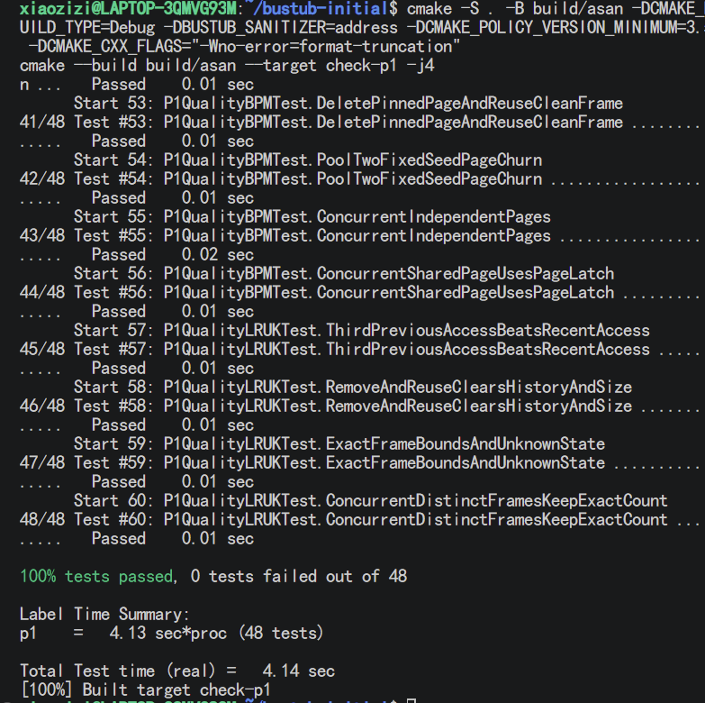

# BusTub Project 1 数据库小组实验

[](https://github.com/milaqihe/bustub-initial/actions/workflows/cmake.yml?query=branch%3Amain)

本仓库为五人小组的 Project 1 提交，包含**可扩展哈希表、LRU-K 置换器、缓冲池管理器的完整源码和运行截图**。默认分支 `main` 为提交版本。

## 提交内容

| 内容 | 查看入口 |
| --- | --- |
| 实验报告、算法设计与流程图 | [实验报告](reports/p1/report.md) |
| 运行截图 | [截图汇总](reports/p1/README.md#运行截图) · [图片目录](reports/p1/images/) |
| 48 项测试与 ASan/TSan 验证记录 | [验收记录](reports/p1/acceptance.md) |
| 最终集成、PR 与版本记录 | [集成记录](reports/p1/integration.md) |
| 默认分支自动构建与测试 | [GitHub Actions](https://github.com/milaqihe/bustub-initial/actions/workflows/cmake.yml?query=branch%3Amain) |

## 核心源码

| 模块 | 头文件 | 实现 | 基础测试 |
| --- | --- | --- | --- |
| 可扩展哈希表 | [extendible_hash_table.h](src/include/container/hash/extendible_hash_table.h) | [extendible_hash_table.cpp](src/container/hash/extendible_hash_table.cpp) | [12 项测试](test/container/hash/extendible_hash_table_test.cpp) |
| LRU-K 置换器 | [lru_k_replacer.h](src/include/buffer/lru_k_replacer.h) | [lru_k_replacer.cpp](src/buffer/lru_k_replacer.cpp) | [13 项测试](test/buffer/lru_k_replacer_test.cpp) |
| 缓冲池管理器 | [buffer_pool_manager_instance.h](src/include/buffer/buffer_pool_manager_instance.h) | [buffer_pool_manager_instance.cpp](src/buffer/buffer_pool_manager_instance.cpp) | [13 项测试](test/buffer/buffer_pool_manager_instance_test.cpp) |

另有 [10 项独立补充测试](test/p1_quality/)，覆盖 K=3 排序、历史清理、边界帧、小容量换页、脏页重载、FlushAll、帧复用与并发。

## 运行结果

- P1 全量测试：**48/48 通过**（38 项基础测试 + 10 项独立补充测试）。
- 2026-11-23 最终 ASan 复跑：48/48 通过；每项用例重复 20 次，**960 次执行全部通过**。
- 格式与 lint 通过；Linux CI 同时执行 clang-tidy 和六文件打包。
- 组员独立 TSan 运行：48/48 通过，原始截图保存在仓库。

下图为组员提交的完整 ASan 运行结果；其他运行截图及其说明见[截图汇总](reports/p1/README.md#运行截图)。



## 复现方法

安装 CMake 3.26 以上和 C++17 编译器，详细安装与 Linux Clang 14 配置见[构建指南](docs/BUILD.md)。在仓库根目录运行：

```bash
git clone https://github.com/milaqihe/bustub-initial.git
cd bustub-initial
cmake -S . -B build -DCMAKE_BUILD_TYPE=Debug -DBUSTUB_SANITIZER=address
cmake --build build --target check-p1 -j 4
```

运行质量测试和基础测试的统一入口为 `check-p1`。CI 使用 Ubuntu 22.04、Clang 14、CMake 3.31.10、Debug + ASan；TSan 使用独立构建目录，配置见[验收记录](reports/p1/acceptance.md)。

## 小组分工

| 编号 | 姓名 | GitHub | 负责内容 |
| --- | --- | --- | --- |
| 1 号 | 何佳绮 | milaqihe | 公共环境与接口、CI、代码审阅合并、最终测试和提交整合 |
| 2 号 | 吴佳忆 | wjy676 | 可扩展哈希表、基础测试、设计说明和拆桶示意图 |
| 3 号 | 吴雅卓 | WUCROW2006 | LRU-K、基础测试、手算示例和设计说明 |
| 4 号 | 梁怡莲 | yawyhdhdn | 缓冲池、基础测试、操作流程图和状态图 |
| 5 号 | 肖子瑞 | xxz00z | 独立质量测试、ASan/TSan 运行截图和验收材料 |

## 课程源码包与参考资料

`cmake --build build --target submit-p1` 生成 `project1-submission.zip`，包含上述三组模块的六个 `.h/.cpp` 文件。成功的 Actions 运行也会提供同名提交包 artifact。老师可直接在本仓库查看全部源码与截图。

课程附带的 [P1_src 原始代码与说明](references/README.md)单独存放在 `references/`，供对照学习；实际构建使用 `src/` 中的小组实现。

协作记录保留在 [Git 工作流](docs/GIT_WORKFLOW.md)、[接口约定](docs/INTERFACES.md)和[五人分工指南](docs/team/README.md)。
