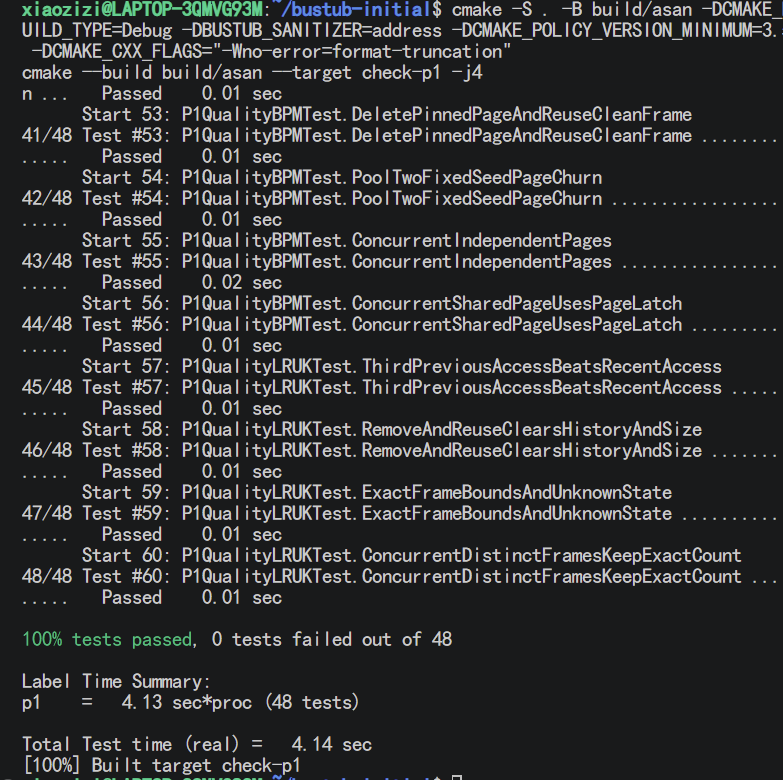
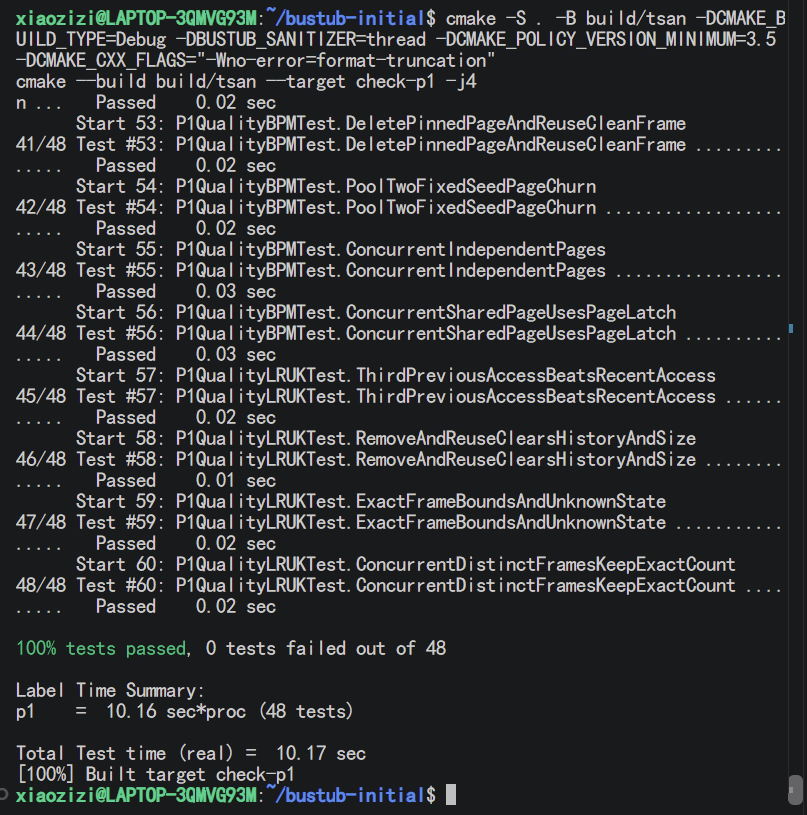
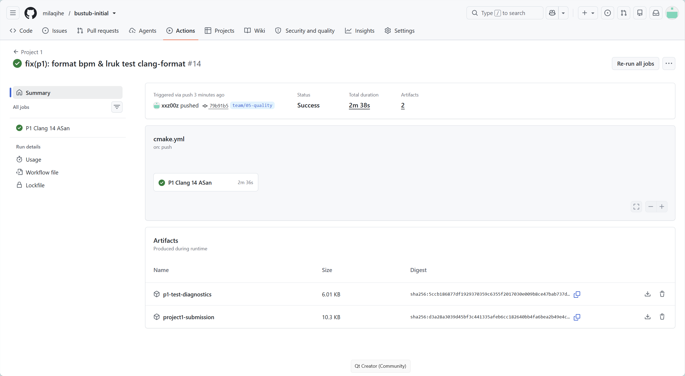
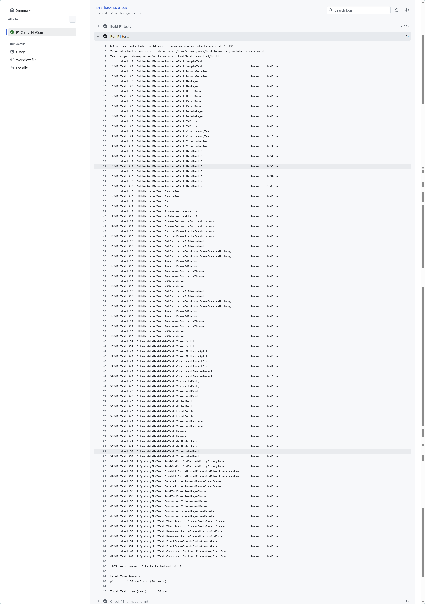
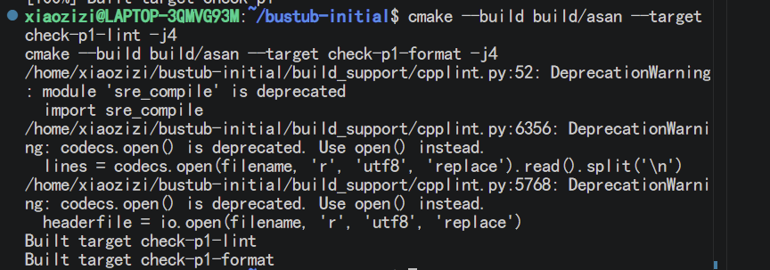

# Project 1 实验报告与运行截图

本目录与 `main` 中的代码共同构成课程提交材料。

| 材料 | 内容 |
| --- | --- |
| [实验报告](report.md) | 三个模块的设计、手算示例、拆桶图、缓冲池流程与状态图、测试结果和分工 |
| [验收记录](acceptance.md) | 48 项测试、Sanitizer、固定种子换页与重复运行结果 |
| [集成记录](integration.md) | 模块 PR、环境、CI 与最终交付过程 |
| [完整图片目录](images/) | 原始运行截图及哈希表设计图 |

## 运行截图

以下截图由 5 号在 2026-11-15 提交，覆盖同一套 48 项 P1 用例。2026-11-23 组长完成最终完整复跑及每项用例 20 次重复运行，结果见[验收记录](acceptance.md)。默认分支最新的 Linux CI 结果见 [Actions](https://github.com/milaqihe/bustub-initial/actions/workflows/cmake.yml?query=branch%3Amain)。

### ASan：48/48 通过

### TSan：48/48 通过

### GitHub Actions 构建与检查

### CI 测试日志

### 格式与 lint

## 设计图

哈希表拆分示意图见[报告第 3 章](report.md#3-哈希表设计)，NewPage、FetchPage、AcquireFrame 和 pin/evictable 状态图见[报告第 5 章](report.md#5-缓冲池设计与流程图)。
