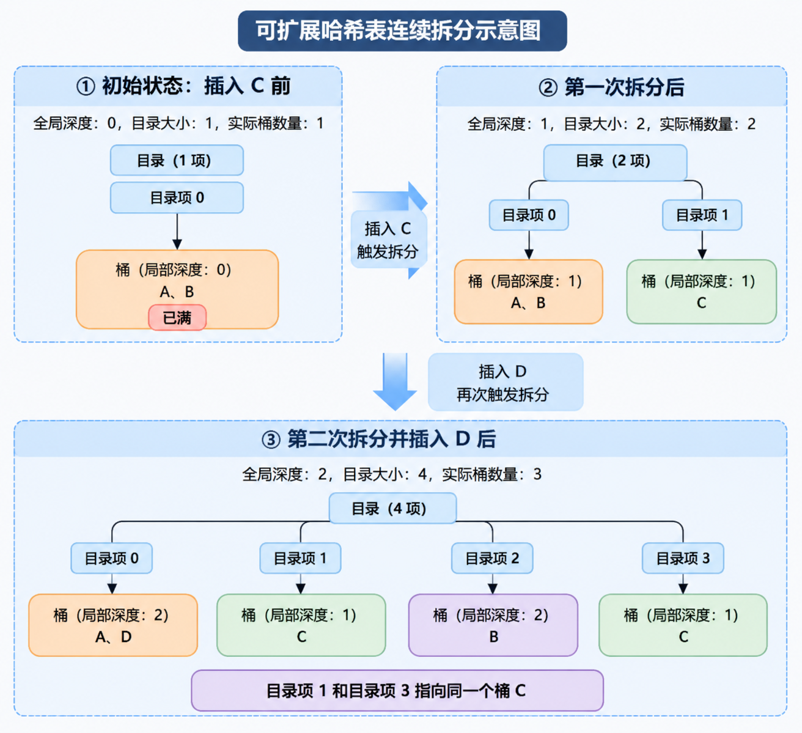
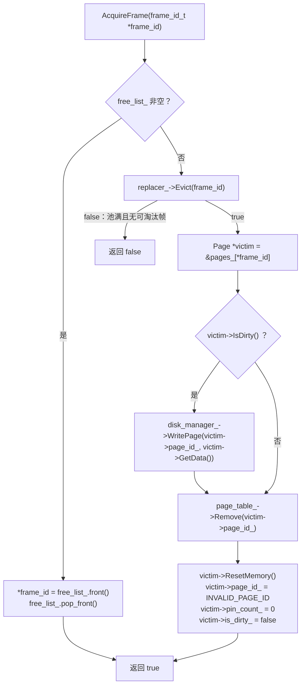
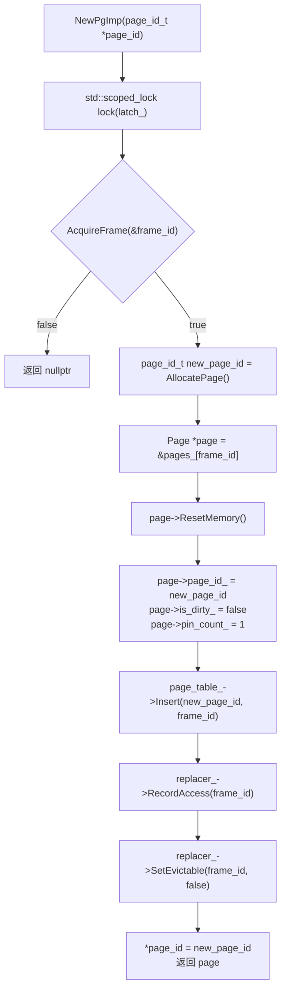
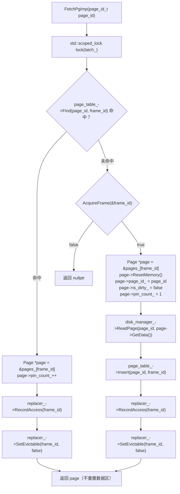
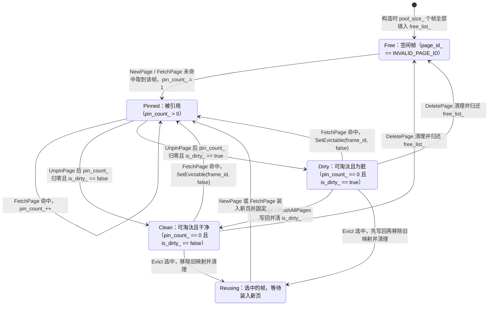

# 数据库 Project 1 实验报告

本报告汇总五人小组完成的可扩展哈希表、LRU-K 和缓冲池实现、测试结果与运行截图。最终整理日期：2026-11-23。源码和运行截图随报告提交至项目默认分支 `main`。

## 1 实验目标与任务

实现 BusTub 的内存可扩展哈希表、LRU-K 置换器与缓冲池管理器。说明各模块如何协作，使数据库能够通过 page_id 请求页面，并正确处理有限缓冲帧、页面固定与脏页持久化。

## 2 开发环境与复现

项目使用 C++17 和 CMake，团队以 GitHub Actions 的 Linux 环境作为统一构建与静态检查环境。组长在 macOS 上独立复跑模块测试，5 号的本地验收环境、命令和截图在 [acceptance.md](acceptance.md) 中单独记录。

| 项目 | 团队 CI 环境 | 1 号本地复跑环境 |
| --- | --- | --- |
| 系统与架构 | Ubuntu 22.04，x86_64 | macOS 26.4，arm64 |
| C/C++ 编译器 | Clang / Clang++ 14 | AppleClang 21.0.0 |
| CMake | 3.31.10（项目要求至少 3.26） | 3.31.10 |
| 格式与静态检查 | clang-format 14、clang-tidy 14、cpplint | clang-format 14.0.6、cpplint；clang-tidy 结果采用 Linux CI |
| 构建与内存检测 | Debug + AddressSanitizer，开启泄漏检测 | Debug + AddressSanitizer |

三个模块共有 38 项基础测试，独立质量测试增加 10 项，合计 48 项。2026-11-23 由组长在 Debug + ASan 环境完整复跑并执行每项用例重复 20 次的稳定性测试；执行结果见 [acceptance.md](acceptance.md)，运行截图见[截图与交付入口](README.md)。模块与报告的集成过程见 [integration.md](integration.md)。

安装步骤见[构建指南](../../docs/BUILD.md)。安装相应工具后，从仓库根目录按以下命令复现 Linux CI 使用的配置：

```bash
git switch main
git pull --ff-only origin main
git rev-parse HEAD

cmake -S . -B build/asan-clang14 -DCMAKE_BUILD_TYPE=Debug \
  -DBUSTUB_SANITIZER=address \
  -DCMAKE_C_COMPILER=clang-14 -DCMAKE_CXX_COMPILER=clang++-14 \
  -DCLANG_FORMAT_BIN=clang-format-14 -DCLANG_TIDY_BIN=clang-tidy-14
ASAN_OPTIONS=detect_leaks=1:halt_on_error=1 \
  cmake --build build/asan-clang14 --target check-p1 -j 4
cmake --build build/asan-clang14 --target check-p1-format check-p1-lint
cmake --build build/asan-clang14 --target check-clang-tidy-p1
```

`check-p1` 先构建三个基础测试目标及符合命名约定的补充测试，再通过 CTest 的 `p1` 标签执行用例；单个用例超时为 120 秒。失败返回非零，诊断输出由 CI 保留。`p1_test.sh` 也可复用已经配置的构建目录运行同一入口。

TSan 使用独立构建目录，以 `-DBUSTUB_SANITIZER=thread` 编译并运行；5 号提交的运行截图显示 48/48 通过，具体记录见验收文档。使用 Clang 19 等其他编译器复测时，新建相应构建目录并记录实际版本，格式与静态检查继续以 CI 的 14 版工具结果为准。

1 号完成测试与集成后，执行 `cmake --build <最终构建目录> --target submit-p1`，生成仓库根目录的 `project1-submission.zip`。压缩包只包含 CMake 中 `P1_FILES` 指定的哈希表、LRU-K、缓冲池三对 `.h/.cpp`，共六个文件。

## 3 哈希表设计

### 3.1 整体结构

本实验实现的是基于可扩展哈希（Extendible Hashing）的内存哈希表，主要用于保存和查找 Key-Value 键值对。与固定目录大小的哈希表不同，可扩展哈希表能够在桶空间不足时，通过拆分桶和调整目录结构来容纳新的数据。

结合实际代码，哈希表主要由目录（Directory）和桶（Bucket）两部分组成。目录负责根据 Key 的哈希值定位对应的桶，桶负责保存具体的键值对。

在本模块中，目录使用 `std::vector<std::shared_ptr<Bucket>>` 保存，每个目录项通过智能指针指向一个桶。桶内部使用 `std::list<std::pair<K, V>>` 保存键值对，同时记录桶的容量和局部深度。

主要成员变量如下：

| 成员变量 | 含义 |
|---|---|
| `dir_` | 哈希表目录，保存指向各个桶的指针 |
| `global_depth_` | 全局深度，决定目录索引使用多少位哈希信息 |
| `bucket_size_` | 每个桶允许存放的最大键值对数量 |
| `num_buckets_` | 当前实际桶的数量 |
| `latch_` | 用于保护哈希表共享状态的互斥锁 |
| `depth_`（Bucket 内部） | 当前桶的局部深度 |

构造函数首先检查桶容量是否大于 0，然后创建一个局部深度为 0 的初始桶，并将其放入目录。初始状态下，全局深度为 0，目录中有 1 个目录项，实际桶数量也为 1。

需要注意，目录项数量不等于实际桶数量。由于多个目录项可以指向同一个桶，因此目录扩展后，目录项数量可能大于实际桶数量。

### 3.2 目录、全局深度与局部深度

全局深度（Global Depth）表示目录索引使用的哈希低位数量。假设全局深度为 \(g\)，那么目录项数量为：

$$
\text{DirectorySize} = 2^g
$$

局部深度（Local Depth）则记录单个桶当前用于区分数据的哈希位数。不同桶的局部深度可以不同。

两者之间的关系如下：

- 全局深度决定整个目录的大小。
- 局部深度属于单个桶，表示该桶已经使用多少位哈希信息进行区分。
- 桶的局部深度不会大于全局深度。
- 当局部深度小于全局深度时，可能有多个目录项指向同一个桶。
- 当局部深度等于全局深度时，如果该桶需要拆分，就必须先扩大目录。

例如，全局深度为 2 时，目录共有 4 个目录项。如果其中两个目录项指向同一个局部深度为 1 的桶，说明这两个目录项对应的哈希低位中，只有一位用于区分该桶。

因此，目录项数量和实际桶数量需要分别理解，不能将目录项数量直接当作桶的数量。

### 3.3 IndexOf 低位索引

程序通过 `IndexOf()` 函数计算 Key 对应的目录下标。其实现是先使用 `std::hash<K>()` 获取 Key 的哈希值，再根据全局深度生成掩码，保留哈希值的低位。

实际代码如下：

```cpp
template <typename K, typename V>
auto ExtendibleHashTable<K, V>::IndexOf(const K &key) -> size_t {
  int mask = (1 << global_depth_) - 1;
  return std::hash<K>()(key) & mask;
}
```

其计算过程可以表示为：

$$
\text{IndexOf}(key)=\text{Hash}(key)\land(2^g-1)
$$

其中，\(g\) 表示全局深度，`&` 表示按位与操作。

例如，全局深度为 2 时，掩码为二进制 `11`。程序通过哈希值的低两位计算目录索引。得到索引后，就可以通过目录找到对应的桶，而不需要遍历所有桶。

### 3.4 查找、插入、更新与删除

**（1）查找操作 Find**

查找操作首先获取互斥锁，然后调用 `IndexOf()` 计算目录索引，通过目录找到对应的桶，最后调用桶内部的 `Find()` 函数遍历链表。

如果找到相同的 Key，就将对应的 Value 写入输出参数，并返回 `true`；如果没有找到，则返回 `false`。

**（2）插入操作 Insert**

插入操作首先根据 Key 计算目录索引，找到对应的桶，然后调用桶内部的 `Insert()` 函数。

桶内部首先检查是否已经存在相同的 Key。如果存在，就直接更新原来的 Value 并返回成功。如果不存在，再判断桶是否已满。桶未满时，将新的键值对加入链表；桶已满时，则返回 `false`。

外层 `Insert()` 函数在收到插入失败的结果后，会调用 `RedistributeBucket()` 拆分当前桶。拆分完成后，程序重新计算待插入 Key 的目录索引，再次尝试插入，直到插入成功。

因此，更新已有 Key 和插入新 Key 的处理方式不同。即使桶已经满了，更新已有 Key 也不会触发桶拆分。

**（3）删除操作 Remove**

删除操作首先计算 Key 对应的目录索引，然后调用对应桶的 `Remove()` 函数。桶内部遍历链表，找到对应 Key 后将其删除，并返回 `true`；如果没有找到，则返回 `false`。

本实验不要求实现桶合并和目录收缩，因此删除操作只负责删除键值对，不会自动合并相邻桶，也不会缩小目录。

### 3.5 桶拆分与目录翻倍

当需要插入的新 Key 所在桶已经满时，程序会调用 `RedistributeBucket()` 进行拆分。

拆分过程主要包括以下步骤：

1. 获取当前桶的局部深度。
2. 判断局部深度是否等于全局深度。如果相等，则将目录扩大为原来的两倍，并增加全局深度。
3. 创建一个新桶，同时将原桶的局部深度增加 1。
4. 根据原桶拆分前的局部深度，确定本次拆分所使用的哈希位。
5. 遍历目录，将原来指向当前桶且满足拆分条件的目录项改为指向新桶。
6. 暂存原桶中的键值对，清空原桶，再根据每个 Key 的哈希索引将键值对重新分配到对应桶中。

如果当前桶的局部深度小于全局深度，就不需要扩大整个目录，只需要调整指向当前桶的部分目录项。只有当局部深度等于全局深度时，才需要进行目录翻倍。

桶拆分后，外层插入函数会重新计算待插入 Key 的目录索引并继续尝试插入。如果拆分后目标桶仍然已满，就会继续进行下一次拆分。

### 3.6 多次拆分的键值分布示例

为了说明目录扩展和多次拆分的过程，下面使用一个桶容量为 2 的示例。假设不同 Key 的哈希低位如下：

| Key | 假设的哈希低位 |
|---|---|
| A | `00` |
| B | `10` |
| C | `01` |
| D | `00` |

这里的二进制数按照从右向左的顺序表示哈希低位，最右侧为最低位。上述数值是为了说明拆分过程而设定的示例，并不是某次程序运行中 `std::hash<int>` 的实际输出。A 和 D 是不同的 Key，只是假设它们的哈希低两位相同。

**第一次拆分**

初始时全局深度为 0，目录只有一个目录项，实际桶数量为 1。A 和 B 已经放入初始桶，桶容量达到上限。此时插入 C，会触发桶拆分。

由于当前局部深度与全局深度相等，程序先将目录扩大为原来的两倍，全局深度增加到 1。接着根据哈希值最低位重新分配键值对：

- A 的最低位为 0，保留在原桶。
- B 的最低位为 0，保留在原桶。
- C 的最低位为 1，进入新桶。

第一次拆分后的结构如下：

```text
全局深度：1
目录大小：2
实际桶数量：2

目录项 0 ────────> 原桶（局部深度 1）
                    A、B

目录项 1 ────────> 新桶（局部深度 1）
                    C
```

此时原桶仍然存放 A 和 B，容量再次达到上限；新桶存放 C。

**第二次拆分**

接下来插入 D。D 的哈希低位为 `00`，因此仍然会定位到目录项 0 对应的原桶。由于原桶已经存满，插入再次触发拆分。

此时原桶的局部深度为 1，全局深度也为 1，因此程序再次将目录扩大为原来的两倍，全局深度变为 2，目录项数量增加到 4。

本次拆分使用哈希值的第二低位进行区分：

- A 的低两位为 `00`，进入目录项 0 对应的桶。
- B 的低两位为 `10`，进入目录项 2 对应的新桶。
- C 的低两位为 `01`，仍然由目录项 1 和目录项 3 指向的桶保存。
- D 的低两位为 `00`，与 A 一样进入目录项 0 对应的桶。

第二次拆分后，原桶中的 A 和 B 被重新分配，随后外层插入函数重新尝试插入 D。最终目录结构如下：

```text
全局深度：2
目录大小：4
实际桶数量：3

目录项 0 ────────> 桶 A
                    局部深度：2
                    A、D

目录项 1 ────────> 桶 C
                    局部深度：1
                    C

目录项 2 ────────> 桶 B
                    局部深度：2
                    B

目录项 3 ────────> 桶 C
                    局部深度：1
                    C
```

可以看到，第二次拆分后，目录项 1 和目录项 3 仍然指向同一个桶。这是因为该桶的局部深度只有 1，而当前全局深度已经增加到 2。

这个例子展示了连续两次拆分的过程：第一次拆分后，原桶仍然可能存满；当后续插入再次命中这个桶时，程序会继续拆分，并在局部深度等于全局深度时再次扩大目录。

**图 3-1 可扩展哈希表连续拆分及键值分布示意图**



### 3.7 数据结构、同步方式与实现特点

在数据结构方面，目录使用 `std::vector<std::shared_ptr<Bucket>>` 管理桶指针，桶内部使用 `std::list<std::pair<K, V>>` 保存键值对。目录和桶分别承担定位与数据存储的职责，多个目录项可以共享指向同一个桶的指针。

在同步方式方面，程序使用 `std::mutex` 定义互斥锁 `latch_`。`Find()`、`Insert()`、`Remove()` 以及公开的深度和桶数量查询函数都通过 `std::scoped_lock<std::mutex>` 获取锁，操作结束后自动释放，从而保护目录和桶的共享状态。

从实现开销来看，普通查找、更新和删除操作需要访问目标桶，并在桶内通过链表查找对应 Key。桶拆分时，程序需要遍历目录调整指针，并重新分配原桶中的键值对，因此拆分操作的开销会高于普通插入。

本模块实现了哈希表的初始化、查找、插入、重复键更新、删除、桶拆分和目录扩展。根据本实验要求，删除操作不涉及桶合并和目录收缩。


## 4 LRU-K 设计

本节由 3 号撰写。代码位置：`src/include/buffer/lru_k_replacer.h`、`src/buffer/lru_k_replacer.cpp`；
用例位置：`test/buffer/lru_k_replacer_test.cpp`（共 13 个用例：原有 4 个 + 补充 9 个）。

### 4.1 淘汰依据：后退 k 距离

实现维护一个只增不减的全局逻辑时钟 `current_timestamp_`：每次 `RecordAccess` 把一个新时间戳写进该帧的历史再让时钟加 1。时钟从不回退也不复用，因此全表时间戳互不相同。

对帧 f，设其最近 m = min(k, 已访问次数) 次访问的时间戳升序为 hist[0] < … < hist[m−1]：

- m = k（成熟帧）：后退 k 距离 = 当前时间戳 − hist[0]，hist[0] 就是倒数第 k 次访问的时间戳。
- m < k（不成熟帧）：按定义后退 k 距离 = +∞。

两档可以共用一个排序键：`std::pair<int, size_t>{hist.size() < k_ ? 0 : 1, hist.front()}`，`Evict` 在所有 `evictable_` 为真的帧里取这个二元组最小的那一个。这样排的依据是：

1. 第一分量 0/1 把 +∞ 组整体排在成熟组之前，也就是访问不足 k 次的帧先淘汰；
2. m < k 时 `hist.front()` 是首次访问时间，m = k 时是倒数第 k 次访问时间，两类各自要比较的就是它，一个 `front()` 够用；
3. 同一类内 `front()` 越小，后退 k 距离越大，越该先淘汰；
4. 比较只用时间戳，不拿当前时钟去做减法：同一轮 Evict 里所有候选的当前时钟相同，减法不改变相对次序，还能避开无符号相减下溢。

成熟帧比较倒数第 k 次访问，而普通 LRU 比较最近一次访问。K=2 的手算过程见 4.4，K=3 的对比示例见 4.5。

每个时间戳只由一次 `RecordAccess` 产生，两个帧不会有相同的 `front()`，所以代码里 `(cand == best && id < victim)` 这个按帧号兜底的平局判断实际不会触发，用于确定性处理平局，不影响本实验序列的结果。

### 4.2 内部数据结构

| 成员 | 类型 | 作用 |
| --- | --- | --- |
| `current_timestamp_` | `size_t` | 全局逻辑时钟，每访问一次加 1 |
| `curr_size_` | `size_t` | 可淘汰帧数，即 `Size()` 的返回值 |
| `replacer_size_` | `size_t` | 合法 frame_id 的上界（构造参数 num_frames） |
| `k_` | `size_t` | K |
| `latch_` | `std::mutex` | 保护全部公有方法 |
| `frames_` | `std::unordered_map<frame_id_t, FrameInfo>` | 只保存出现过的帧 |
| `FrameInfo::history_` | `std::list<size_t>` | 该帧最近的访问时间戳，升序，长度 ≤ k |
| `FrameInfo::evictable_` | `bool` | 是否可被淘汰，**新条目默认 false** |

构造函数里有 `BUSTUB_ASSERT(k_ > 0, "LRU-K requires k >= 1")`，K=0 的置换器没有意义。

选型理由：

- 用 `std::list` 而不是 `std::vector`：只需要尾部追加、头部丢弃（`push_back` / `pop_front`）和读 `front()`，不按下标随机访问。新访问进来后长度超过 k 就弹掉头部，头部永远是倒数第 k 次访问，`front()` 直接就是排序键。
- 用 `std::unordered_map` 而不是数组：frame_id 的定义域是 [0, num_frames)，真正被访问的只是其中稀疏的一部分，哈希表只存出现过的帧。它还区分得开“从未出现”和“存在但不可淘汰”：`Remove` 对前者直接返回，对后者抛异常。

### 4.3 四个写操作与 Size 的状态变化

| 操作 | 前置检查 | 对 `frames_` 的影响 | 对 `curr_size_` 的影响 | 异常 |
| --- | --- | --- | --- | --- |
| `RecordAccess(f)` | 越界检查 | 不存在则新建 `FrameInfo`（`evictable_ = false`）；追加新时间戳；长度超过 k 弹掉头部 | **不变**（新帧默认不可淘汰） | `std::invalid_argument` |
| `SetEvictable(f, b)` | 越界检查 | 用 `find` 查；不存在或状态已相同则**直接返回、不建条目**；否则改 `evictable_` | 不可淘汰 → 可淘汰：+1；反向：−1 | `std::invalid_argument` |
| `Evict(&f)` | `curr_size_ == 0` 先返回 false | 删除被选中帧的整个条目（历史一并消失） | −1（仅成功时） | 无 |
| `Remove(f)` | 越界检查 | 不存在则返回；存在但不可淘汰则抛；否则删除条目 | −1（仅成功时） | `std::invalid_argument` |
| `Size()` | 无 | 不改 | 不改 | 无 |

三条容易写错的语义（每条都有对应用例）：

1. `Size()` 只数可淘汰帧，既不是历史长度，也不等于 `frames_.size()`。`RecordAccess` 不改变它：新帧默认不可淘汰，所以访问本身不增加 Size。
2. `SetEvictable` 必须幂等，对从未出现过的帧不能建条目（用 `find` 而不是 `operator[]`）。否则会留下一个没有历史、后退 k 距离恒为 +∞ 的幽灵帧，将来被 Evict 选中却没有任何页与之对应。
3. `Evict` 成功时已经连同历史一起删掉了该帧条目，所以上层（BPM）淘汰后不需要再调 `Remove`。`Remove` 只用于“指定某个帧、不管它的优先级”的场景，例如 `DeletePage`。对不可淘汰帧调 `Remove` 要抛异常，这一点和老师 Tutorial 的叙述不同，以头文件注释和 `docs/INTERFACES.md` 为准。

### 4.4 K=2 的手算序列与代码输出

场景与 `test/buffer/lru_k_replacer_test.cpp` 的 `LRUKReplacerTest.SampleTest` 完全相同：K=2，7 个帧，时间戳从 0 起。

第一步：分配时间戳。先依次访问帧 1–6，再访问一次帧 1。

| 访问序号 | 1 | 2 | 3 | 4 | 5 | 6 | 7 |
| --- | --- | --- | --- | --- | --- | --- | --- |
| 帧 | 1 | 2 | 3 | 4 | 5 | 6 | 1 |
| 时间戳 | 0 | 1 | 2 | 3 | 4 | 5 | 6 |

此时各帧历史与排序键（帧 1–5 可淘汰，帧 6 不可淘汰，`Size() = 5`）：

| 帧 | history（≤ 2 个） | m | 类别 | 排序键 |
| --- | --- | --- | --- | --- |
| 1 | [0, 6] | 2 | 成熟 | (1, 0) |
| 2 | [1] | 1 | +∞ | (0, 1) |
| 3 | [2] | 1 | +∞ | (0, 2) |
| 4 | [3] | 1 | +∞ | (0, 3) |
| 5 | [4] | 1 | +∞ | (0, 4) |
| 6 | [5] | 1 | +∞ | 不可淘汰，不参与 |

三次 Evict 依次选中帧 2、3、4（+∞ 组按首次访问时间递增），`Size()` 从 5 降到 2，剩下帧 1 与帧 5。

第二步：继续分配时间戳。访问 3、4、5、4：

| 访问序号 | 8 | 9 | 10 | 11 |
| --- | --- | --- | --- | --- |
| 帧 | 3 | 4 | 5 | 4 |
| 时间戳 | 7 | 8 | 9 | 10 |

| 帧 | history | m | 类别 | 排序键 |
| --- | --- | --- | --- | --- |
| 1 | [0, 6] | 2 | 成熟 | (1, 0) |
| 3 | [7] | 1 | +∞ | (0, 7) |
| 4 | [8, 10] | 2 | 成熟 | (1, 8) |
| 5 | [4, 9] | 2 | 成熟 | (1, 4) |

第 4 次 Evict 选中帧 3：(0, 7) < (1, 0)。帧 1 的 `front()` 是 0，比帧 3 的 7 更旧，但帧 1 是成熟帧，第一分量 1 大于帧 3 的 0：+∞ 组整体优先，两类之间不比 `front()` 大小。这一步最容易写错。

接着把帧 6 置为可淘汰，它只有一次访问（时间戳 5），排序键 (0, 5)，第 5 次 Evict 选中帧 6。

再把帧 1 置为不可淘汰（Size 由 3 降到 2），第 6 次 Evict 在帧 4 (1, 8) 与帧 5 (1, 4) 中取更小的 front，选中帧 5。

第三步：历史裁剪。再连续两次访问帧 1（时间戳 11、12）。K=2 时历史只保留最近 2 个，`push_back` 后长度变成 3 便把头部弹掉，帧 1 的历史从 [0, 6] 变成 [11, 12]，`front()` 从 0 变成 11，帧 1 因此重新变年轻：

| 帧 | history | 排序键 |
| --- | --- | --- |
| 1 | [11, 12] | (1, 11) |
| 4 | [8, 10] | (1, 8) |

第 7 次 Evict 选中帧 4，第 8 次选中帧 1，`Size()` 归零；此后 `Evict` 返回 false。

真实代码输出（把 main 上的 `lru_k_replacer.cpp` 和真实头文件编成可执行文件运行，逐条断言与上表一致）：

```text
=== 场景 1  K=2, num_frames=7  (重放 SampleTest, 时间戳从 0 起) ===
   1  RecordAccess(1)-> t=0
   2  RecordAccess(2)-> t=1
   3  RecordAccess(3)-> t=2
   4  RecordAccess(4)-> t=3
   5  RecordAccess(5)-> t=4
   6  RecordAccess(6)-> t=5
        SetEvictable(1, true )   Size=0
        SetEvictable(2, true )   Size=1
        SetEvictable(3, true )   Size=2
        SetEvictable(4, true )   Size=3
        SetEvictable(5, true )   Size=4
        SetEvictable(6, false)   Size=5
        Size()=5  (期望 5)  OK
  -- 再访问帧 1：1 变为成熟(2 次)，其余仍是 +inf --
   7  RecordAccess(1)-> t=6
  Evict() -> true , victim=2, Size=4   [+inf 组按最早时间戳：2 的 front=1]
  Evict() -> true , victim=3, Size=3   [front=2]
  Evict() -> true , victim=4, Size=2   [front=3; 6 不可淘汰]
        Size()=2  (期望 2)  OK
  -- 新建 3、4，更新 5、4：3 只有 1 次访问，仍在 +inf 组 --
   8  RecordAccess(3)-> t=7
   9  RecordAccess(4)-> t=8
  10  RecordAccess(5)-> t=9
  11  RecordAccess(4)-> t=10
        SetEvictable(3, true )   Size=2
        SetEvictable(4, true )   Size=3
        Size()=4  (期望 4)  OK
  Evict() -> true , victim=3, Size=3   [+inf 组先于成熟组：3 class=0 而 1 class=1(front=0)]
        Size()=3  (期望 3)  OK
  -- 帧 6 转为可淘汰：它只有 1 次访问(front=5) --
        SetEvictable(6, true )   Size=3
        Size()=4  (期望 4)  OK
  Evict() -> true , victim=6, Size=3   [+inf 组]
        Size()=3  (期望 3)  OK
  -- 帧 1 转为不可淘汰 --
        SetEvictable(1, false)   Size=3
        Size()=2  (期望 2)  OK
  Evict() -> true , victim=5, Size=1   [成熟组按第 2 次先前访问：5 的 front=4 < 4 的 front=8]
        Size()=1  (期望 1)  OK
  -- 再访问帧 1 两次：历史裁剪为最近 2 次，front 变为 11 --
  12  RecordAccess(1)-> t=11
  13  RecordAccess(1)-> t=12
        SetEvictable(1, true )   Size=1
        Size()=2  (期望 2)  OK
  Evict() -> true , victim=4, Size=1   [front=8 < 1 的 front=11]
        Size()=1  (期望 1)  OK
  Evict() -> true , victim=1, Size=0   [最后只剩帧 1]
        Size()=0  (期望 0)  OK
  Evict() 在空置器上返回 false（期望 false）

=== 场景 2  K=1（退化为普通 LRU）===
   1  RecordAccess(0)-> t=0
   2  RecordAccess(1)-> t=1
   3  RecordAccess(0)-> t=2
        SetEvictable(0, true )   Size=0
        SetEvictable(1, true )   Size=1
        Size()=2  (期望 2)  OK
  Evict() -> true , victim=1, Size=1   [K=1 时排序键就是最近一次访问时间，即 LRU]

=== 场景 3  K=3（最近访问更晚的帧仍然先出队）===
   1  RecordAccess(0)-> t=0
   2  RecordAccess(1)-> t=1
   3  RecordAccess(1)-> t=2
   4  RecordAccess(1)-> t=3
   5  RecordAccess(0)-> t=4
   6  RecordAccess(0)-> t=5
        SetEvictable(0, true )   Size=0
        SetEvictable(1, true )   Size=1
        Size()=2  (期望 2)  OK
  Evict() -> true , victim=0, Size=1   [0 的第 3 次先前访问是 t=0，1 的是 t=1；0 更大 -> 淘汰 0]

ALL TRACE CHECKS PASS  (fails=0)
```

淘汰顺序 2、3、4、3、6、5、4、1 与 `SampleTest` 中的 8 处 `ASSERT_EQ` 逐条对应。

### 4.5 K=1 与 K=3 的验证

K=1 必须退化成普通 LRU。K=1 时历史长度恒为 1，排序键恒为 (1, 最近一次访问时间)，Evict 选最早被访问的帧，与教科书 LRU 一致；此时不存在 +∞ 组（m = min(1, 已访问次数) ≥ 1）。用例 `K1BehavesLikePlainLRU`，轨迹程序里 K=1 依次访问 0、1、0 后淘汰 1。

**K=3 时要能区分最近访问与倒数第 3 次访问。** 用例 `ThirdPreviousAccessBeatsRecentAccess`：K=3，帧 0 在时间戳 0、4、5 被访问，帧 1 在时间戳 1、2、3 被访问。

| 帧 | history | 倒数第 3 次访问 | 最近一次访问 |
| --- | --- | --- | --- |
| 0 | [0, 4, 5] | 0 | 5（更新） |
| 1 | [1, 2, 3] | 1 | 3 |

帧 0 的最近一次访问（5）比帧 1 的（3）更晚，按 LRU 该淘汰帧 1；但按 LRU-K 比较的是倒数第 3 次访问，0 < 1，所以**淘汰帧 0**。程序输出 `victim=0`，用例断言一致。这一条同时说明：K 的选择直接决定了谁被淘汰，K 越小越接近 LRU。

### 4.6 同步方式与复杂度

五个公有方法（`Evict`、`RecordAccess`、`SetEvictable`、`Remove`、`Size`）第一行都是 `std::scoped_lock<std::mutex> lock(latch_)`，临界区覆盖从查帧、改历史到改 `curr_size_` 的整个过程，检查与修改之间没有竞态窗口；`Evict` 的候选扫描也在锁内，不会出现两个线程同时选中同一受害帧。类用 `DISALLOW_COPY_AND_MOVE` 禁止拷贝，避免锁与容器被意外复制。

| 操作 | 时间复杂度 | 说明 |
| --- | --- | --- |
| `RecordAccess` | O(1) 均摊 | 哈希表定位 + `list` 尾插/头删 |
| `SetEvictable` | O(1) 均摊 | 只用 `find`，不建条目 |
| `Remove` | O(1) 均摊 | 同上 |
| `Size` | O(1) | 直接返回计数器 |
| `Evict` | O(F) | F 为正在追踪的帧数，≤ 缓冲池帧数；线性扫描全部帧 |
| 空间 | O(F·k) | 每帧至多 k 个时间戳 |

`Evict` 是唯一的线性操作。可以维护两个有序结构（+∞ 组按首次访问时间、成熟组按倒数第 k 次访问时间）把单次淘汰降到 O(log F)，但本项目 F 很小（缓冲池默认 10 帧，最大用例 1000 帧），线性扫描常数更小、实现也更简单，所以没做。

### 4.7 两个实现要点的取舍

一、越界判定必须同时挡住负数与上界。三个写操作统一用

```cpp
if (frame_id < 0 || static_cast<size_t>(frame_id) >= replacer_size_) {
  throw std::invalid_argument("...: frame id out of range");
}
```

合法区间是 [0, replacer_size)，所以 `frame_id == num_frames` 与 `frame_id == -1` 都要抛。只写 `frame_id > replacer_size_` 会让 `-1` 和 `== num_frames` 都漏过，随后以负下标访问哈希表或越界写历史。用例 `InvalidFrameIdThrows` 与 5 号的 `ExactFrameBoundsAndUnknownState` 都覆盖了这两侧边界。

二、另一种常见写法是两条链表，本实现换成一张表加一个可比较的排序键。那种写法把帧分成未满 k 次的一条、满 k 次的一条，每次访问把帧挪到链表尾。这样在成熟组里排的是最近一次访问的顺序，而 LRU-K 要的是倒数第 k 次访问的顺序，两者只在 k=1 时一致。要让链表顺序正确，就得在每次访问时额外维护第 k 次访问的时间戳并据此移动结点，复杂度反而上升。

本实现把“该淘汰谁”收成一个二元组 `{是否成熟, front()}`：`history_` 只保留最近 k 个时间戳并保持升序，`front()` 就是该帧要比的那个时间戳，两类之间用第一分量隔开。四个写操作都成了局部更新，Evict 只需扫一遍取最小键，逻辑与 4.1 一致，也不会出现“链表位置和淘汰顺序不一致”这类隐性 bug。

## 5 缓冲池设计与流程图

### 5.1 模块组成

| 成员 | 类型 | 作用 |
| --- | --- | --- |
| `pages_` | `Page *`（`new Page[pool_size_]`） | 帧数组，下标即帧号；每帧存放一页的 4KB 数据与元数据 `page_id_`、`pin_count_`、`is_dirty_` |
| `page_table_` | `ExtendibleHashTable<page_id_t, frame_id_t> *` | 页号到帧号的映射，命中判断全部依赖它 |
| `replacer_` | `LRUKReplacer *` | 记录每帧的访问历史与可淘汰状态，决定池满时淘汰谁 |
| `free_list_` | `std::list<frame_id_t>` | 尚未装入任何页的空闲帧号 |
| `disk_manager_` | `DiskManager *` | 提供 `ReadPage`、`WritePage`，按 `page_id × 4096` 计算磁盘偏移 |
| `latch_` | `std::mutex` | 保护以上所有结构，六个接口入口统一加锁 |
| `next_page_id_` | `std::atomic<page_id_t>` | 由 `AllocatePage()` 递增分配新页号 |

帧的选取逻辑集中在一个内部辅助函数 `AcquireFrame` 中，由 `NewPage` 与 `FetchPage` 的未命中路径共用，避免两处重复同一套淘汰代码。

### 5.2 帧分配：AcquireFrame



顺序上有三个要点：

1. **空闲帧优先**：`free_list_` 还有帧时直接取用，不惊动替换器；
2. **写回早于清空**：写回依赖 `victim` 的 `page_id_` 与 `GetData()`，一旦执行 `ResetMemory()` 与 `page_id_ = INVALID_PAGE_ID`，两者都已消失。把 `page_table_->Remove` 放在写回之后，保证"帧里装着页 ⇒ 页表中必有该映射"这条关系全程成立；
3. **四个字段全部复位**：其中 `page_id_ = INVALID_PAGE_ID` 是 `FlushAllPgsImp` 判断"空帧"的依据，该函数遍历的是 `pages_` 全部帧，漏掉这行会让空帧被当成有效页写回磁盘。

### 5.3 NewPage



新页返回时 `pin_count_ = 1`，调用者必须先 `UnpinPage`，它才可能被淘汰。

### 5.4 FetchPage



命中路径**不做** `ResetMemory()`：内存中的内容已经是最新数据，清零会直接抹掉它；只有未命中、需要从磁盘读入时才先清零。

### 5.5 其余四个接口

| 接口 | 关键步骤 | 返回值语义 |
| --- | --- | --- |
| `UnpinPgImp(page_id, is_dirty)` | `page_table_->Find` → `pin_count_ <= 0` 直接拒绝 → `pin_count_--` → `is_dirty` 为真时置 `is_dirty_ = true`（**只置真，不清假**）→ 仅当计数归零才 `SetEvictable(frame_id, true)` | 页不在池中或计数已为 0 时返回 `false` |
| `FlushPgImp(page_id)` | `page_id == INVALID_PAGE_ID` 直接拒绝 → `Find` → **无论脏否都调用** `WritePage(page_id, page->GetData())` → `is_dirty_ = false` | 页不在池中返回 `false` |
| `FlushAllPgsImp()` | 取一次锁，遍历 `pages_` 全部帧，`page_id_ != INVALID_PAGE_ID` 才视为有效页，逐帧 `WritePage` 并清 `is_dirty_` | 无返回值（`void`） |
| `DeletePgImp(page_id)` | `Find` 失败直接返回 `true`（幂等）→ `pin_count_ > 0` 返回 `false` → 依次 `page_table_->Remove`、`replacer_->Remove`、`free_list_.push_back` → 复位四字段 → `DeallocatePage(page_id)` | 不在池中或删除成功为 `true`，被 pin 住为 `false` |

四个易错点：

1. `UnpinPage(is_dirty=false)` 不能清除已有脏标记，否则一次无心的 unpin 会把尚未落盘的修改"洗白"，数据静默丢失；
2. `FlushPage` 不判断脏否都要写，因为调用方要求的是"把这一页的内容落盘"，保证磁盘上此页内容是最新的；
3. `DeletePage` **不写回**：页是被销毁而不是迁走；同时必须把 `page_id_` 复位为 `INVALID_PAGE_ID`；
4. `DeallocatePage` 在当前框架中是空实现（骨架注释说明暂无可回收页号的数据结构），页号不会被复用。

### 5.6 pin 与 evictable 的状态迁移



五个状态的含义（Reusing 是持有 BPM 锁期间的内部过渡状态）：

- **Free**：`page_id_ == INVALID_PAGE_ID`，位于 `free_list_`；
- **Pinned**：`pin_count_ > 0`，`replacer_` 中标记为不可淘汰，任何淘汰都不会选它；
- **Clean**：`pin_count_ == 0 && is_dirty_ == false`，是 `Evict` 的候选且淘汰时无需写回；
- **Dirty**：`pin_count_ == 0 && is_dirty_ == true`，仍是候选，但被选中时必须先 `WritePage`。
- **Reusing**：帧已从替换器移除，由当前 New/Fetch 调用立即复用；它不会重新加入 `free_list_`。

`DeletePage` 只在 `pin_count_ == 0` 时才能执行，`pin > 0` 会返回 `false`，因为持有者仍在读写的帧一旦被清空，其指针就会落到别人的数据上。

### 5.7 关键不变量与死锁避免

实现中始终维持以下不变量：

1. **映射与帧内挂牌一致**：`page_table_` 中每条 `page_id → frame_id`，该帧的 `page_id_` 必须等于这个 `page_id`；
2. **可淘汰集合与 pin 集合一致**：`replacer_` 中标记为可淘汰的帧，正好是池内 `pin_count_ == 0` 的帧；
3. **命中不重置内存**：`FetchPage` 命中路径只改计数与替换器状态；
4. **脏标记只置真**：`UnpinPage(is_dirty=false)` 不得清掉已有脏标记；
5. **删除不写回且必须复位 `page_id_`**：否则 `FlushAllPgsImp` 会把已删除的页重新写回磁盘；
6. **`free_list_` 中的帧必为空帧**：`AcquireFrame` 从空闲链表取帧时不再清零，因此归还前必须完成复位。

`FlushAllPages` 的死锁避免方式：实现中 `FlushAllPgsImp` **没有调用** `FlushPgImp`。`std::mutex` 不可重入，而 `FlushAllPgsImp` 已经持有了 `latch_`，若再调用入口同样加锁的 `FlushPgImp`，同一线程会二次加锁并永久阻塞。因此它在持锁状态下直接遍历 `pages_` 数组、直接调用 `disk_manager_->WritePage`，把"公开接口"与"内部批量实现"分成两条路径。

## 6 测试方法与结果

采用“模块基础测试 + 独立边界测试 + ASan/TSan + 重复执行”的验证方式。完整执行记录、对应版本及参数见 [acceptance.md](acceptance.md)，[运行截图](README.md)随代码保存在仓库中。

| 测试套件 | 数量 | 主要覆盖 |
| --- | --- | --- |
| ExtendibleHashTableTest | 12 | 插入、更新、删除、拆分、目录深度、桶数量及并发 |
| LRUKReplacerTest | 13 | K=1/2/3、淘汰顺序、计数、历史清理、非法帧与并发 |
| BufferPoolManagerInstanceTest | 13 | 页面六操作、二进制数据、dirty、换页、并发与综合场景 |
| P1QualityLRUKTest | 4 | 第 K 次访问排序、Remove 后复用、边界帧编号、多线程精确计数 |
| P1QualityBPMTest | 6 | 容量 1/2、全 pinned、脏页重载、FlushAll、删除复用、固定种子换页与并发 |
| **合计** | **48** | P1 全部已注册用例 |

| 实验项 | 环境与执行方式 | 实际结果 |
| --- | --- | --- |
| 完整 P1 功能与 ASan 复跑 | 2026-11-23，组长本机 AppleClang 21，Debug + ASan，`check-p1` | 48/48 通过 |
| 重复稳定性测试 | 同一 ASan 构建，`ctest -L '^p1$' --repeat until-fail:20` | 每项用例执行 20 次，共 960 次全部通过，耗时 90.34 秒 |
| 格式与 lint | `check-p1-format`、`check-p1-lint` | 通过 |
| Linux CI | Ubuntu 22.04、Clang 14、Debug + ASan | 48/48；格式、lint、clang-tidy 与打包通过，最终记录见 Actions |
| TSan | 5 号 2026-11-15 独立 Linux 运行截图 | 截图显示 48/48 通过，耗时 10.17 秒 |

固定种子换页测试实际使用 2 个缓冲帧、100 个页面、种子 `20261115`，先逐页写入并解除固定，再打乱页序读回并逐项比较。独立页和共享页并发测试均使用 4 个线程，每线程 100 次操作；共享页写入时使用 Page 的写锁。每个 CTest 用例设置 120 秒超时。

## 7 问题与修复

以下记录项目实际遇到并解决的构建与集成问题。

### 1 号：统一构建与集成中解决的问题

1. **新 macOS SDK 下的第三方头文件告警导致编译失败。** 本机使用 AppleClang 21 编译时，第三方依赖中的告警会与项目的 `-Werror` 一起阻断构建。通过将第三方头文件目录设置为 SYSTEM 包含路径，保留项目源代码的严格告警检查；同时让构建辅助脚本由 Python 解释器调用，避免依赖压缩包解压后的脚本执行权限。改动随 [PR #2](https://github.com/milaqihe/bustub-initial/pull/2) 合入，后续三组 P1 测试程序均能构建。
2. **本机 clang-tidy 14 与新 SDK 不兼容。** 该工具无法正常解析本机 SDK，静态检查统一放到 Ubuntu 22.04 / Clang 14 的 CI 执行。本机负责复跑功能测试，Linux CI 负责统一工具版本下的静态检查；[质量分支的 CI](https://github.com/milaqihe/bustub-initial/actions/runs/43722662432) 中编译、48 项测试、格式、lint 和 clang-tidy 全部通过。
3. **缓冲池功能通过后，CI 仍因注释格式失败。** 审阅 [PR #4](https://github.com/milaqihe/bustub-initial/pull/4) 时，缓冲池 13 项和三模块合计 38 项测试均通过，但 cpplint 报告 24 处 `//` 后缺少空格。以提交 `ed7f342` 修正注释空格，本地格式和 lint 复查通过，[修正后的 CI](https://github.com/milaqihe/bustub-initial/actions/runs/43397652660) 全部通过，随后合入 `main`。

## 8 小组分工与贡献

| 编号 | 姓名 | 负责内容 | 实际 PR/提交与结果 |
| --- | --- | --- | --- |
| 1 | 何佳绮 | 环境、接口、公共配置、审阅合并、最终联调和提交包 | [PR #2](https://github.com/milaqihe/bustub-initial/pull/2) 建立 P1 构建、CI、接口与打包入口；审阅合并 [#1](https://github.com/milaqihe/bustub-initial/pull/1)、[#3](https://github.com/milaqihe/bustub-initial/pull/3)、[#4](https://github.com/milaqihe/bustub-initial/pull/4)，本地复跑哈希表 12 项、LRU-K 13 项、缓冲池 13 项；修复缓冲池注释格式 `ed7f342`。完成最终测试复跑、报告汇总、源码及运行截图的默认分支交付。 |
| 2 | 吴佳忆 | 可扩展哈希表、基础测试与算法说明 | [PR #1](https://github.com/milaqihe/bustub-initial/pull/1)，实现及 12 项基础测试；`043b0c8`、`b0b7f79` 补充第 3 章和拆桶示意图。 |
| 3 | 吴雅卓 | LRU-K、基础测试与淘汰示例 | [PR #3](https://github.com/milaqihe/bustub-initial/pull/3)，13 项测试通过；`cc2dc2b` 补充第 4 章、K=1/2/3 示例及复杂度说明。 |
| 4 | 梁怡莲 | 缓冲池六操作、基础与集成测试、状态流程 | [PR #4](https://github.com/milaqihe/bustub-initial/pull/4)，13 项基础测试通过；`fbb0e9c` 补充第 5 章流程与状态图。 |
| 5 | 肖子瑞 | 补充测试、Sanitizer、缺陷复测、报告与答辩整理 | `56945da`、`79b91b5` 提交 10 项独立补充用例；`bd966e1` 提交验收记录与 ASan、TSan、CI、格式检查截图。 |

## 9 答辩准备

- **1 号：为什么按这个顺序集成？** 缓冲池通过哈希表维护 `page_id → frame_id` 映射，通过 LRU-K 选择可淘汰帧，因此先合入公共构建配置，再分别验收哈希表与 LRU-K，最后审阅已经接入真实依赖的缓冲池。各模块基础测试通过后，再接入 5 号的独立补充测试，便于定位单模块问题和调用约定问题。实际顺序与版本见 [integration.md](integration.md) 的 PR 表。
- **1 号：如何复现测试与打包？** 先同步要验收的分支并记录提交号，按第 2 章配置 Debug + ASan，执行 `check-p1`、格式、lint 和 clang-tidy；TSan 在独立目录运行。最终 `main` 验收通过后执行 `submit-p1`，根据 `CMakeLists.txt` 的 `P1_FILES` 核对压缩包的六个源码文件。`test/CMakeLists.txt` 负责测试发现、P1 标签与超时，`cmake/Project1.cmake` 定义统一测试入口，`.github/workflows/cmake.yml` 记录 CI 的实际执行顺序。
- **2 号：何时拆桶、何时翻倍？** 新键插入满桶时拆桶；桶局部深度等于全局深度时先翻倍目录。已有键先更新值，因此满桶更新不需要增加桶。代码位置：`src/container/hash/extendible_hash_table.cpp` 的 `Bucket::Insert`、`Insert`、`RedistributeBucket`。
- **3 号：为何 A=1/9、B=2/3 时 K=2 淘汰 A？Size 统计什么？** A 的倒数第二次访问为 1，早于 B 的 2，因此 A 的后退 K 距离更大；两者均可淘汰且历史都达到 K 次时先选 A。`Size` 只统计可淘汰帧。代码位置：`src/buffer/lru_k_replacer.cpp` 的 `Evict`、`SetEvictable`、`Size`。
- **4 号：为什么 pinned 页不能淘汰？** 调用者仍持有页指针，复用帧会让该指针访问另一页的数据。`UnpinPage(false)` 保留先前的 dirty 标记，脏页淘汰前先写回，再清映射并复用。`FlushAllPgsImp` 持锁直接遍历写回，避免调用会再次获取相同锁的 `FlushPgImp`。代码位置：`src/buffer/buffer_pool_manager_instance.cpp`。
- **5 号：独立补充测试验证什么？ASan 与 TSan 各查什么？** 补充用例独立规定 K=3 排序、历史重置、小容量帧复用、FlushAll 和并发的预期结果；ASan 检测内存错误，TSan 检测数据竞争。出现失败时保留输入、被测提交与日志，修复后重跑相同用例。代码位置：`test/p1_quality/`，结果见 `acceptance.md`。
