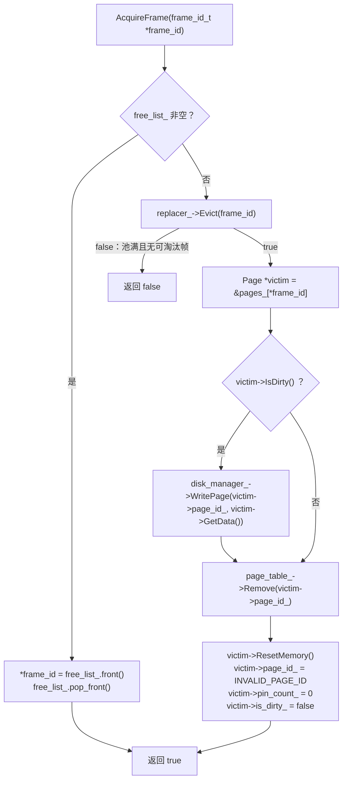
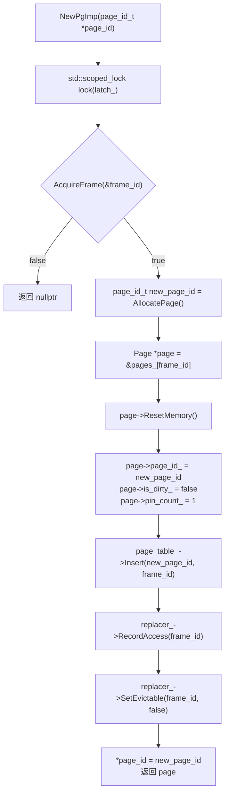
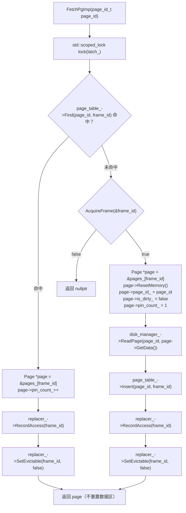
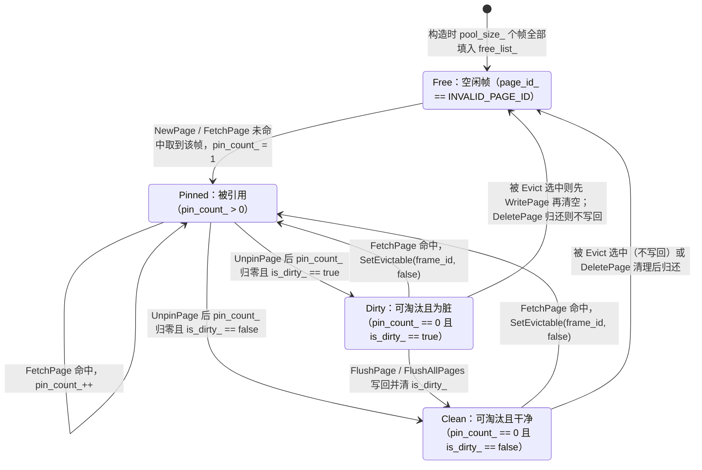

# 数据库 Project 1 实验报告

填写人：5 号主笔，1—4 号提供对应内容。状态：报告编写中；1 号已补环境、集成问题、个人贡献与答辩说明，各模块设计和测试章节由对应成员继续完善。课程如有固定模板，由 5 号迁移内容、1 号核对提交格式。

## 1 实验目标与任务

实现 BusTub 的内存可扩展哈希表、LRU-K 置换器与缓冲池管理器。说明各模块如何协作，使数据库能够通过 page_id 请求页面，并正确处理有限缓冲帧、页面固定与脏页持久化。

## 2 开发环境与复现

项目使用 C++17 和 CMake，团队以 GitHub Actions 的 Linux 环境作为统一构建与静态检查环境。组长在 macOS 上独立复跑模块测试，5 号的本地验收环境、命令和截图在 [acceptance.md](acceptance.md) 中单独记录。

| 项目 | 团队 CI 环境 | 1 号本地复跑环境 |
| --- | --- | --- |
| 系统与架构 | Ubuntu 22.04，x86_64 | macOS 26.4，arm64 |
| C/C++ 编译器 | Clang / Clang++ 14 | AppleClang 21.0.0 |
| CMake | 3.31.10（项目要求至少 3.26） | 3.31.10 |
| 格式与静态检查 | clang-format 14、clang-tidy 14、cpplint | clang-format 14.0.6、cpplint；clang-tidy 结果采用 Linux CI |
| 构建与内存检测 | Debug + AddressSanitizer，开启泄漏检测 | Debug + AddressSanitizer |

截至 2026-11-16，`main` 的三个模块集成版本为 `dfa3c63`，已有 38 项基础测试通过；`team/05-quality` 的 `bd966e1` 在此基础上加入 10 项补充测试，CI 共 48 项通过。两阶段版本、PR 和执行记录见 [integration.md](integration.md)，最终提交版本在报告汇总合并后确定。

安装步骤见[构建指南](../../docs/BUILD.md)。安装相应工具后，从仓库根目录按以下命令复现 Linux CI 使用的配置；使用质量分支可运行当前补充测试。

```bash
git switch team/05-quality
git pull --ff-only origin team/05-quality
git rev-parse HEAD

cmake -S . -B build/asan-clang14 -DCMAKE_BUILD_TYPE=Debug \
  -DBUSTUB_SANITIZER=address \
  -DCMAKE_C_COMPILER=clang-14 -DCMAKE_CXX_COMPILER=clang++-14 \
  -DCLANG_FORMAT_BIN=clang-format-14 -DCLANG_TIDY_BIN=clang-tidy-14
ASAN_OPTIONS=detect_leaks=1:halt_on_error=1 \
  cmake --build build/asan-clang14 --target check-p1 -j 4
cmake --build build/asan-clang14 --target check-p1-format check-p1-lint
cmake --build build/asan-clang14 --target check-clang-tidy-p1
```

`check-p1` 先构建三个基础测试目标及符合命名约定的补充测试，再通过 CTest 的 `p1` 标签执行用例；单个用例超时为 120 秒。失败返回非零，诊断输出由 CI 保留。`p1_test.sh` 也可复用已经配置的构建目录运行同一入口。

TSan 使用独立构建目录，以 `-DBUSTUB_SANITIZER=thread` 编译并运行；具体命令和实际结果由 5 号记录在验收文档中。使用 Clang 19 等其他编译器复测时，新建相应构建目录并记录实际版本，格式与静态检查继续以 CI 的 14 版工具结果为准。

最终版本合入 `main` 后，由 1 号复跑上述测试和检查，再执行 `cmake --build <最终构建目录> --target submit-p1`，生成仓库根目录的 `project1-submission.zip`。压缩包只包含 CMake 中 `P1_FILES` 指定的哈希表、LRU-K、缓冲池三对 `.h/.cpp`，共六个文件。

## 3 哈希表设计

2 号补充：

- directory、bucket、全局深度、局部深度与实际桶数的关系。
- `IndexOf` 低位索引、插入、已有 key 更新和删除流程。
- 桶拆分与目录翻倍的条件，以及多次拆分的具体示例。
- 使用的数据结构、同步方式和实现复杂度。
- 一幅实际键值分布的拆分前后图。

## 4 LRU-K 设计

3 号补充：

- 后退 K 距离、访问不足 K 次的优先级和成熟候选的排序依据。
- 每帧历史、逻辑时间戳、可淘汰标记与 Size 的维护。
- RecordAccess / SetEvictable / Evict / Remove 的状态转换。
- K=2 的手算序列与代码输出；补充 K=1/3 的验证。
- 同步方式、操作复杂度与实际采用的内部数据结构。

## 5 缓冲池设计与流程图

### 5.1 模块组成

| 成员 | 类型 | 作用 |
| --- | --- | --- |
| `pages_` | `Page *`（`new Page[pool_size_]`） | 帧数组，下标即帧号；每帧存放一页的 4KB 数据与元数据 `page_id_`、`pin_count_`、`is_dirty_` |
| `page_table_` | `ExtendibleHashTable<page_id_t, frame_id_t> *` | 页号到帧号的映射，命中判断全部依赖它 |
| `replacer_` | `LRUKReplacer *` | 记录每帧的访问历史与可淘汰状态，决定池满时淘汰谁 |
| `free_list_` | `std::list<frame_id_t>` | 尚未装入任何页的空闲帧号 |
| `disk_manager_` | `DiskManager *` | 提供 `ReadPage`、`WritePage`，按 `page_id × 4096` 计算磁盘偏移 |
| `latch_` | `std::mutex` | 保护以上所有结构，六个接口入口统一加锁 |
| `next_page_id_` | `std::atomic<page_id_t>` | 由 `AllocatePage()` 递增分配新页号 |

帧的选取逻辑集中在一个私有辅助函数 `AcquireFrame` 中，由 `NewPage` 与 `FetchPage` 的未命中路径共用，避免两处重复同一套淘汰代码。

### 5.2 帧分配：AcquireFrame



顺序上有三个要点：

1. **空闲帧优先**：`free_list_` 还有帧时直接取用，不惊动替换器；
2. **写回早于清空**：写回依赖 `victim` 的 `page_id_` 与 `GetData()`，一旦执行 `ResetMemory()` 与 `page_id_ = INVALID_PAGE_ID`，两者都已消失。把 `page_table_->Remove` 放在写回之后，保证"帧里装着页 ⇒ 页表中必有该映射"这条关系全程成立；
3. **四个字段全部复位**：其中 `page_id_ = INVALID_PAGE_ID` 是 `FlushAllPgsImp` 判断"空帧"的依据，该函数遍历的是 `pages_` 全部帧，漏掉这行会让空帧被当成有效页写回磁盘。

### 5.3 NewPage



新页返回时 `pin_count_ = 1`，调用者必须先 `UnpinPage`，它才可能被淘汰。

### 5.4 FetchPage



命中路径**不做** `ResetMemory()`：内存中的内容已经是最新数据，清零会直接抹掉它；只有未命中、需要从磁盘读入时才先清零。

### 5.5 其余四个接口

| 接口 | 关键步骤 | 返回值语义 |
| --- | --- | --- |
| `UnpinPgImp(page_id, is_dirty)` | `page_table_->Find` → `pin_count_ <= 0` 直接拒绝 → `pin_count_--` → `is_dirty` 为真时置 `is_dirty_ = true`（**只置真，不清假**）→ 仅当计数归零才 `SetEvictable(frame_id, true)` | 页不在池中或计数已为 0 时返回 `false` |
| `FlushPgImp(page_id)` | `page_id == INVALID_PAGE_ID` 直接拒绝 → `Find` → **无论脏否都调用** `WritePage(page_id, page->GetData())` → `is_dirty_ = false` | 页不在池中返回 `false` |
| `FlushAllPgsImp()` | 取一次锁，遍历 `pages_` 全部帧，`page_id_ != INVALID_PAGE_ID` 才视为有效页，逐帧 `WritePage` 并清 `is_dirty_` | 无返回值（`void`） |
| `DeletePgImp(page_id)` | `Find` 失败直接返回 `true`（幂等）→ `pin_count_ > 0` 返回 `false` → 依次 `page_table_->Remove`、`replacer_->Remove`、`free_list_.push_back` → 复位四字段 → `DeallocatePage(page_id)` | 不在池中或删除成功为 `true`，被 pin 住为 `false` |

四个易错点：

1. `UnpinPage(is_dirty=false)` 不能清除已有脏标记，否则一次无心的 unpin 会把尚未落盘的修改"洗白"，数据静默丢失；
2. `FlushPage` 不判断脏否都要写，因为调用方要求的是"把这一页的内容落盘"，保证磁盘上此页内容是最新的；
3. `DeletePage` **不写回**：页是被销毁而不是迁走；同时必须把 `page_id_` 复位为 `INVALID_PAGE_ID`；
4. `DeallocatePage` 在当前框架中是空实现（骨架注释说明暂无可回收页号的数据结构），页号不会被复用。

### 5.6 pin 与 evictable 的状态迁移



四个状态的含义：

- **Free**：`page_id_ == INVALID_PAGE_ID`，位于 `free_list_`；
- **Pinned**：`pin_count_ > 0`，`replacer_` 中标记为不可淘汰，任何淘汰都不会选它；
- **Clean**：`pin_count_ == 0 && is_dirty_ == false`，是 `Evict` 的候选且淘汰时无需写回；
- **Dirty**：`pin_count_ == 0 && is_dirty_ == true`，仍是候选，但被选中时必须先 `WritePage`。

`DeletePage` 只在 `pin_count_ == 0` 时才能执行，`pin > 0` 会返回 `false`，因为持有者仍在读写的帧一旦被清空，其指针就会落到别人的数据上。

### 5.7 关键不变量与死锁避免

实现中始终维持以下不变量：

1. **映射与帧内挂牌一致**：`page_table_` 中每条 `page_id → frame_id`，该帧的 `page_id_` 必须等于这个 `page_id`；
2. **可淘汰集合与 pin 集合一致**：`replacer_` 中标记为可淘汰的帧，正好是池内 `pin_count_ == 0` 的帧；
3. **命中不重置内存**：`FetchPage` 命中路径只改计数与替换器状态；
4. **脏标记只置真**：`UnpinPage(is_dirty=false)` 不得清掉已有脏标记；
5. **删除不写回且必须复位 `page_id_`**：否则 `FlushAllPgsImp` 会把已删除的页重新写回磁盘；
6. **`free_list_` 中的帧必为空帧**：`AcquireFrame` 从空闲链表取帧时不再清零，因此归还前必须完成复位。

`FlushAllPages` 的死锁避免方式：实现中 `FlushAllPgsImp` **没有调用** `FlushPgImp`。`std::mutex` 不可重入，而 `FlushAllPgsImp` 已经持有了 `latch_`，若再调用入口同样加锁的 `FlushPgImp`，同一线程会二次加锁并永久阻塞。因此它在持锁状态下直接遍历 `pages_` 数组、直接调用 `disk_manager_->WritePage`，把"公开接口"与"内部批量实现"分成两条路径。

## 6 测试方法与结果

5 号从[验收记录](acceptance.md)提取真实结果，表格包含测试目标、输入规模、环境、通过/失败数量、Sanitizer 和耗时。明确基础测试、补充边界、并发与压力各自验证什么。

| 实验项 | 被测代码版本 | 参数与命令 | 实际结果 |
| --- | --- | --- | --- |
| 三组基础测试 | 待填 | 待填 | 未执行 |
| 补充边界测试 | 待填 | 待填 | 未执行 |
| ASan | 待填 | 待填 | 未执行 |
| TSan | 待填 | 待填 | 未执行 |
| 并发与压力 | 待填 | 待填 | 未执行 |

## 7 问题与修复

选择实际遇到的问题，按“触发输入→错误现象→根因→修复→回归结果”描述，并引用修复 PR 或提交。未发生的问题不写成亲自调试经历。

### 1 号：统一构建与集成中解决的问题

1. **新 macOS SDK 下的第三方头文件告警导致编译失败。** 本机使用 AppleClang 21 编译时，第三方依赖中的告警会与项目的 `-Werror` 一起阻断构建。通过将第三方头文件目录设置为 SYSTEM 包含路径，保留项目源代码的严格告警检查；同时让构建辅助脚本由 Python 解释器调用，避免依赖压缩包解压后的脚本执行权限。改动随 [PR #2](https://github.com/milaqihe/bustub-initial/pull/2) 合入，后续三组 P1 测试程序均能构建。
2. **本机 clang-tidy 14 与新 SDK 不兼容。** 该工具无法正常解析本机 SDK，静态检查统一放到 Ubuntu 22.04 / Clang 14 的 CI 执行。本机负责复跑功能测试，Linux CI 负责统一工具版本下的静态检查；[质量分支的 CI](https://github.com/milaqihe/bustub-initial/actions/runs/43722662432) 中编译、48 项测试、格式、lint 和 clang-tidy 全部通过。
3. **缓冲池功能通过后，CI 仍因注释格式失败。** 审阅 [PR #4](https://github.com/milaqihe/bustub-initial/pull/4) 时，缓冲池 13 项和三模块合计 38 项测试均通过，但 cpplint 报告 24 处 `//` 后缺少空格。以提交 `ed7f342` 修正注释空格，本地格式和 lint 复查通过，[修正后的 CI](https://github.com/milaqihe/bustub-initial/actions/runs/43397652660) 全部通过，随后合入 `main`。

## 8 小组分工与贡献

| 编号 | 负责内容 | 实际 PR/提交与结果 |
| --- | --- | --- |
| 1 | 环境、接口、公共配置、审阅合并、最终联调和提交包 | [PR #2](https://github.com/milaqihe/bustub-initial/pull/2) 建立 P1 构建、CI、接口与打包入口；审阅合并 [#1](https://github.com/milaqihe/bustub-initial/pull/1)、[#3](https://github.com/milaqihe/bustub-initial/pull/3)、[#4](https://github.com/milaqihe/bustub-initial/pull/4)，本地复跑哈希表 12 项、LRU-K 13 项、缓冲池 13 项；修复缓冲池注释格式 `ed7f342`。最终验收、打包与课程提交在报告汇总合并后执行。 |
| 2 | 可扩展哈希表、基础测试与算法说明 | 待填 |
| 3 | LRU-K、基础测试与淘汰示例 | 待填 |
| 4 | 缓冲池六操作、基础与集成测试、状态流程 | 待填 |
| 5 | 补充测试、Sanitizer、缺陷复测、报告与答辩整理 | 待填 |

## 9 答辩准备

- **1 号：为什么按这个顺序集成？** 缓冲池通过哈希表维护 `page_id → frame_id` 映射，通过 LRU-K 选择可淘汰帧，因此先合入公共构建配置，再分别验收哈希表与 LRU-K，最后审阅已经接入真实依赖的缓冲池。各模块基础测试通过后，再接入 5 号的独立补充测试，便于定位单模块问题和调用约定问题。实际顺序与版本见 [integration.md](integration.md) 的 PR 表。
- **1 号：如何复现测试与打包？** 先同步要验收的分支并记录提交号，按第 2 章配置 Debug + ASan，执行 `check-p1`、格式、lint 和 clang-tidy；TSan 在独立目录运行。最终 `main` 验收通过后执行 `submit-p1`，根据 `CMakeLists.txt` 的 `P1_FILES` 核对压缩包的六个源码文件。`test/CMakeLists.txt` 负责测试发现、P1 标签与超时，`cmake/Project1.cmake` 定义统一测试入口，`.github/workflows/cmake.yml` 记录 CI 的实际执行顺序。
- 2 号：何时拆桶、何时翻倍？为什么满桶更新已有键不拆分？
- 3 号：为何 A=1/9、B=2/3 时 K=2 淘汰 A？Size 统计什么？
- 4 号：页被 pin 为什么不能淘汰？dirty 如何避免丢失？FlushAll 如何避免死锁？<br>
        ①这一页被淘汰后，持有者的指针还指向这同一块内存，会写到别的页上；持有者还没有写完、还没unpin，数据是不完整的，此刻写回磁盘，存的是不完整数据。<br>
        ②Unpin时只置真，不归0；淘汰前必写回；先写回再清空。<br>
        ③绕开公开接口，走内部现实（不调用FlushPgImp函数）<br>
- 5 号：哪些边界是独立补充的？ASan 与 TSan 分别查什么？某缺陷如何稳定复现和证明已修复？

各人根据实际代码补上回答与关键源码位置，避免只背概念。
